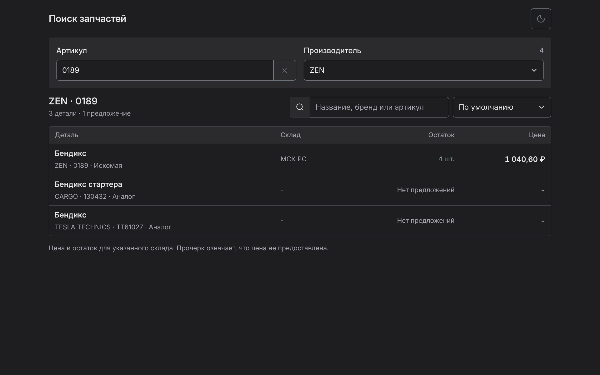
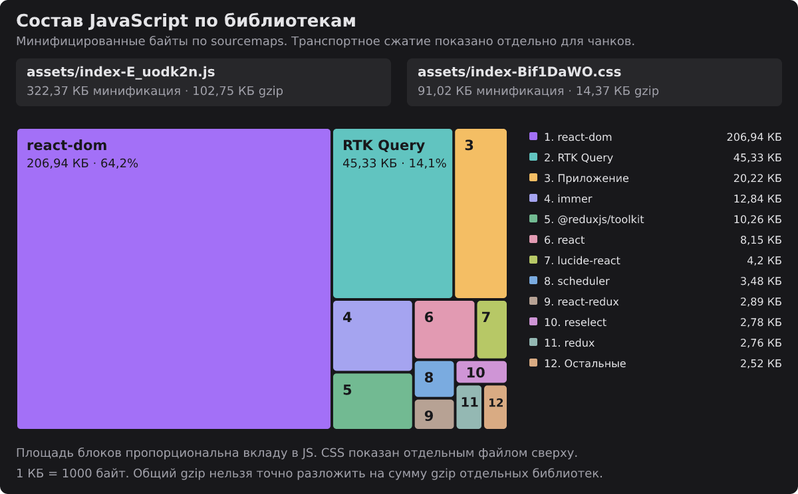
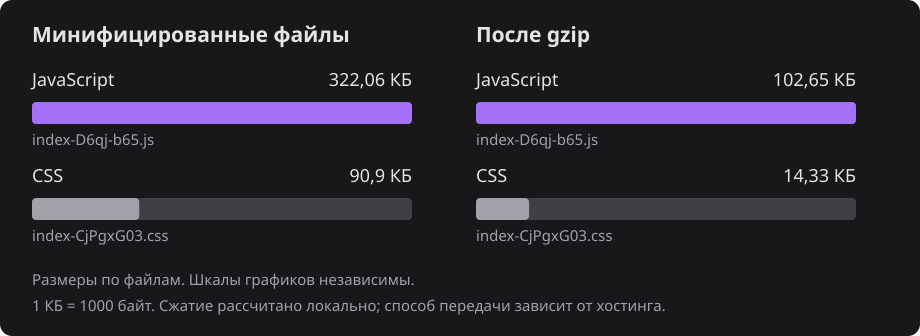

# Favorit Parts



React-приложение для поиска автозапчастей и аналогов через API Favorit Parts. JavaScript без TypeScript, Redux Toolkit / RTK Query, Bootstrap, Lucide, Vite и Bun.

## Локальный запуск

Нужен Bun **1.4.4**. Версия закреплена в `mise.toml`; при использовании mise сначала выполните `mise install`.

```sh
bun install --frozen-lockfile
cp .env.example .env
bun run dev
```

Открыть <http://127.0.0.1:5173>. Если Bun доступен только через mise, команды можно запускать как `mise exec -- bun run dev`.

Пример проверки:

1. Ввести `0189` и дождаться списка производителей.
2. Выбрать `ZEN`.
3. Появятся запрошенная деталь, аналоги, цены и остатки по каждому складу.

Также можно попробовать `01089` или `7160500039S`. Данные живые, наличие и цены меняются.

В `.env.example` указан публичный ключ из примеров [официального PDF](https://lk.favorit-parts.ru/static/wsprice.pdf). После копирования в `.env` приложение обращается к настоящему API. Доступность публичного ключа зависит от владельца сервиса.

`VITE_FAVORIT_API_KEY` задаёт ключ, `VITE_FAVORIT_API_URL` задаёт адрес сервиса. `.env` и `.env.local` исключены из Git. После изменения настроек перезапустите dev-сервер или пересоберите приложение; на GitHub Pages конфигурация фиксируется при сборке. Workflow использует публичные значения из `.env.example`.

## Поведение

- Поиск производителей выполняется через 400 мс после ввода; пустой ввод не отправляется.
- Выбор бренда запускает запрос с артикулом, производителем и `analogues=on`.
- После поиска все найденные бренды доступны кнопками в блоке «Выберите производителя». Нажатие выбирает значение в select и сразу запрашивает предложения. У кнопок обычное Bootstrap-скругление 6 px.
- При смене артикула выбранный бренд и видимые предложения сбрасываются сразу. Ответы привязаны к аргументам запроса; старый ответ не подменяет текущий результат.
- Каждая строка таблицы - отдельное складское предложение. Аналоги без предложений тоже видны: цена обозначена прочерком. Нулевая цена и отсутствие цены различаются.
- Локальный поиск по результатам учитывает название, бренд и артикул, регистр и разделители артикула. Несколько слов уточняют запрос. Фильтрация не обращается к API; очистка восстанавливает выдачу, смена артикула или производителя сбрасывает фильтр.
- Предложения сортируются по цене (в обе стороны), остатку (сначала больше) или названию. По умолчанию сохранён порядок ответа сервиса. Сортировка общая для всех складских предложений, одинаковая в таблице и мобильном списке; неизвестные цены/остатки идут последними в соответствующем режиме, нули учитываются как обычные значения. Смена артикула или бренда сбрасывает сортировку.
- Поиск в результатах и сортировка остаются на странице во время загрузки, ошибки и выбора производителя. Пока предложений нет, контролы неактивны; сами поля не размонтируются при повторном запросе.
- Обработаны загрузка, отсутствие результатов, ошибки API внутри HTTP 200, сетевые и HTTP-ошибки, некорректный JSON и тайм-аут 15 секунд. Запрос после ошибки можно повторить.
- Поля артикула и производителя находятся над результатами; бренд выбирается через нативный select. На узком экране поля идут последовательно, а результаты отображаются списком с подписями склада, остатка и цены, без горизонтальной прокрутки.
- Ошибки показаны постоянными Bootstrap `alert` рядом с соответствующим этапом. Сообщение содержит кнопку «Повторить запрос»; toast-библиотеки не используются.
- При первом открытии включена **тёмная тема**. Кнопка с Lucide переключает «Тёмная → Светлая → Авто → Тёмная»; текущий и следующий режимы доступны в подсказке и для экранного диктора. Выбор сохраняется в `localStorage` и имеет приоритет над значением по умолчанию. В явно выбранном режиме «Авто» оформление следует системе и реагирует на её изменение. Переключение работает и при недоступном хранилище. Начальная тема устанавливается до рендера React.
- Хедер занимает 48 px. Favicon: янтарная шестерня с графитовым контуром на прозрачном фоне, SVG 472 байта. Три концепта созданы встроенным imagegen; выбранная шестерня реализована в SVG для малого размера. Заголовок вкладки: «Тестовое».

## Ссылка на текущий поиск

Артикул, бренд, локальный фильтр и сортировка сохраняются в URL. Например:

```text
http://localhost:5173/?number=0189&brand=ZEN&q=cargo&sort=price-asc
```

- `number` - артикул, включая ведущие нули.
- `brand` - выбранный производитель.
- `q` - локальный фильтр по результатам.
- `sort` - `price-asc`, `price-desc`, `stock-desc`, `name-asc`; для порядка по умолчанию параметр не нужен.

Состояние восстанавливается при загрузке страницы и переходах «Назад/Вперёд». Артикул записывается после паузы 400 мс; смена бренда и сортировки создаёт запись истории, локальный фильтр обновляет текущую запись, не добавляя каждый введённый символ в историю. Очистка удаляет ненужные параметры. Путь размещения, посторонние параметры и hash сохраняются, спецсимволы кодируются автоматически.

Производитель из ссылки проверяется по результатам первого этапа. Регистр приводится к имени из API; неизвестный бренд и связанные с ним фильтр/сортировка сбрасываются без дополнительной записи истории. Ошибочное значение сортировки заменяется значением по умолчанию. API-ключ в параметры поиска не добавляется.

## Проверка и сборка

```sh
bun test
bun run build
bun run preview
```

Production-сборка - в `dist/`; локальная проверка сборки - <http://127.0.0.1:4173>. HTML из `dist` следует открывать через HTTP-сервер, не через `file://`.

Тесты проверяют особенности ответа API, складские цены, нулевые и отсутствующие значения, кодирование параметров, ошибки и независимость результатов при ответах в обратном порядке.

Проверено 16.11.2026: 19 тестов проходят, production-сборка создаётся. В Chromium проверены живой поиск `0189 → ZEN`, прямые ссылки и reload, Back/Forward, отмена отложенной записи URL после перехода назад, исправление некорректных параметров и неизвестного бренда. Сортировка проверена на нескольких складах, нулевых и отсутствующих значениях; порядок desktop/mobile одинаковый, фильтр и сортировка не создают API-запросов. На ширинах 320-1280 px горизонтальной прокрутки нет. Подтверждены тёмная тема первого открытия при светлой системе и приоритет сохранённого «Авто». Ранее проверены пустые ответы, ошибки и повтор, системные изменения темы и недоступный `localStorage`. Production-сборка также проверена по вложенному пути `/favorit-parts/`.

## Размер и производительность



Верхние блоки показывают отдельные JS/CSS-файлы и их gzip. Карта ниже оценивает вклад библиотек в **минифицированный JS до транспортного сжатия** по sourcemaps. Неатрибутированные байты отнесены к служебному коду. Gzip отдельных библиотек нельзя точно складывать: повторяющиеся строки сжимаются совместно внутри чанка. [Данные по библиотекам и чанкам](docs/bundle-libraries.json), [SVG-версия картинки](docs/assets/bundle-libraries.svg).

Обновить PNG, SVG, JSON и интерактивный отчёт:

```sh
bun run analyze
```

Интерактивная карта модулей создаётся в `.local/bundle/stats.html`, исходные данные visualizer в `.local/bundle/stats.json`. Аналитическая сборка с sourcemaps находится в `.local/bundle/dist`; обычная сборка для публикации остаётся в `dist` без sourcemaps. Visualizer и SVG/PNG renderer подключены только как инструменты разработки.



Замер 16.11.2026: один JS-чанк **102,75 КБ gzip** и CSS **14,37 КБ gzip**, вместе **117,12 КБ**. До выборочного подключения Bootstrap CSS занимал 31,79 КБ gzip. [Точные размеры файлов, gzip и Brotli](docs/bundle-size.json). КБ здесь равен 1000 байт; размеры не включают HTTP-заголовки и ответы API.

Повторить сборку, измерить каждый файл и обновить графики:

```sh
bun run size
```

В JS используются production-версии React и Redux, из Lucide включены только пять импортированных иконок. JavaScript Bootstrap не подключён. [Выборочные Sass-импорты](https://getbootstrap.com/docs/5.3/customize/optimize/#lean-sass-imports) оставляют нужные компоненты и семейства utilities, включая responsive-варианты. Sass используется только при сборке. Vite минифицирует JS/CSS и создаёт имена файлов с хешами. Скриншот и графики README находятся вне `public` и `dist`, поэтому в загрузку приложения не попадают.

Для сборки `a92b568`, до изменения хедера и панели выбора бренда, в локальном Chrome trace при повторной загрузке пустого поиска получены LCP 137 мс и CLS 0, без замедления CPU и сети. Это диагностический замер на ноутбуке с прогретым кешем, он не показывает скорость на мобильной сети или время ответа внешнего API. Локальный preview подтвердил gzip для JS/CSS; Brotli в отчёте рассчитан отдельно. Сжатие и кеширование на GitHub Pages нужно проверить после публикации. Производительность на больших выдачах отдельно не измерялась.

При выборочном подключении Bootstrap сравнивались размеры, цвета, типографика и компоновка результатов, форм, ошибок и лоадеров на ширинах 320, 768 и 1280 px в обеих темах. Проверенные стили совпали с полной сборкой Bootstrap. Затем отдельно проверены постоянная панель фильтров при загрузке, ошибке и повторе, синхронизация кнопок брендов с select и компактный хедер.

Сравнение через Vite `build.minify` на одном исходном коде: Oxc 102,75 КБ gzip, Terser 5.51.2 с одним проходом 103,75 КБ, с двумя проходами 103,67 КБ. [Параметры и результаты сравнения](docs/minifier-comparison.json). Оставлен стандартный [Oxc](https://vite.dev/config/build-options#build-minify); Terser не добавлен в зависимости проекта. Поясняющие комментарии из исходников убраны, лицензионные уведомления зависимостей сохранены. Обфускация не подключена: некоторые её преобразования [увеличивают размер и замедляют код](https://github.com/javascript-obfuscator/javascript-obfuscator#controlflowflatteningthreshold).

Вариант с fetch и Redux async actions сохранён отдельно в ветке `prototype/fetch-requests`, коммит `6071e03`. В эксперименте JS занимал 86,51 КБ gzip против 102,75 КБ с RTK Query. [Снимок сравнения](docs/rtk-query-comparison.json). В `main` выбран RTK Query: Redux уже обязателен по ТЗ, а [документация Redux рекомендует RTK Query по умолчанию для загрузки и кеширования данных](https://redux.js.org/usage/side-effects-approaches#recommendations). Это позволяет оставить меньше собственного кода для состояний и жизненного цикла запросов.

## GitHub Pages

Подготовлен workflow `.github/workflows/pages.yml`: установка из lockfile, тесты, сборка и публикация после push в `main`. В pull request выполняются только тесты и сборка.

Для публикации:

1. Загрузить проект в GitHub-репозиторий.
2. В **Settings → Pages → Build and deployment → Source** выбрать **GitHub Actions**.
3. Сделать push в `main` или запустить workflow **Check and deploy to Pages** вручную из `main`.

`base: './'` позволяет разместить сборку как в корне домена, так и по пути `/<имя-репозитория>/`. Сервер приложению не нужен: HTTPS API разрешает CORS для обычных GET-запросов. Конфигурация Pages подготовлена; внешняя публикация в рамках локальной реализации не выполнялась.

## Устройство проекта

Redux указан в техническом задании. Здесь search slice хранит артикул, производителя, фильтр и сортировку, а RTK Query управляет запросами, их состояниями и кешем ответов на 30 секунд после последней подписки. URL синхронизируется с этим состоянием. Для столь небольшого приложения без требования Redux достаточно React hooks; дополнительные менеджеры состояния не нужны.

- `src/api.js` - два endpoint RTK Query, тайм-аут и перевод ошибок в понятные сообщения.
- `src/parts.js` - преобразование данных API, локальный фильтр и сортировка складских предложений.
- `src/store.js` - Redux store, артикул, бренд, фильтр и сортировка.
- `src/searchUrl.js` - чтение/запись параметров, нормализация и синхронизация History API.
- `src/App.jsx` - запросы и переключение состояний страницы.
- `src/components/` - поле поиска, производители, таблица, загрузка и сообщения.
- `src/components/ResultsView.jsx` - фильтр, сортировка, счётчик и компактная таблица; `ThemeToggle.jsx` - кнопка выбора темы с Lucide.
- `src/hooks/useColorMode.js` - выбор темы, системные настройки и сохранение предпочтения; ранняя инициализация размещена в `index.html`.
- `src/styles.css` - палитра «графит + индиго» через CSS-переменные Bootstrap для обеих тем и небольшой набор правил для фокуса, контролов и таблицы. Основная компоновка собрана стандартными Bootstrap-компонентами и utilities.
- `src/bootstrap.scss` - используемые компоненты и семейства utilities Bootstrap.
- `scripts/bundle-report.mjs` - размеры файлов и сжатия, JSON и графики для README.
- `scripts/analyze-bundle.mjs` и `scripts/bundle-library-report.mjs` - visualizer с sourcemaps, интерактивный отчёт и PNG/SVG-карта библиотек для README.

Согласован вариант **Sol**: поля сверху, результаты во всю ширину, мобильный список. Палитра - **графит + индиго**, ошибки - постоянные **alerts**. Исследования Terra/Sol, макеты, подбор цветов и окончательный выбор сохранены отдельно в ветке `prototype/sol-redesign`. Первоначальные варианты A/B/C остались в `prototype/design`; в `main` кода прототипов нет. Коммиты оформлены по Conventional Commits.

## Особенности API

Документация: [«Проценка», 06.03.2023](https://lk.favorit-parts.ru/static/wsprice.pdf).

Используется `https://api.favorit-parts.ru/hs/hsprice/`. Цена и остаток берутся только из `warehouses[].price` и `warehouses[].stock`. Верхнее поле `goods[].price` устарело, документация запрещает его использовать. Массивы `analogues` раскрываются в общий список, одинаковые товары и предложения объединяются. Неуказанный код склада отображается как «Склад N».

16.11.2026 подтверждены HTTPS, разрешающий CORS и оба этапа поиска настоящими запросами из браузера на localhost. Развёртывание на самом GitHub Pages пока не проверялось.

Для `0189 / HAFFEN` 16.11.2026 API вернул HTTP 403 с `Request quota exceeded!`, тогда как контрольный `0189 / ZEN` с тем же публичным ключом вернул HTTP 200. Согласно PDF, это лимит поиска по грузовому ассортименту для покупательского ключа. Такой ответ отображается как ошибка, а не пустая выдача: наличие HAFFEN из него определить нельзя.

При необходимости публичный ключ можно переопределить через `VITE_FAVORIT_API_KEY` в `.env.local`. Любой `VITE_*` параметр попадает в клиентскую сборку; для закрытого покупательского ключа потребуется серверный прокси. Для этого тестового используется исключительно публичный ключ из PDF.
